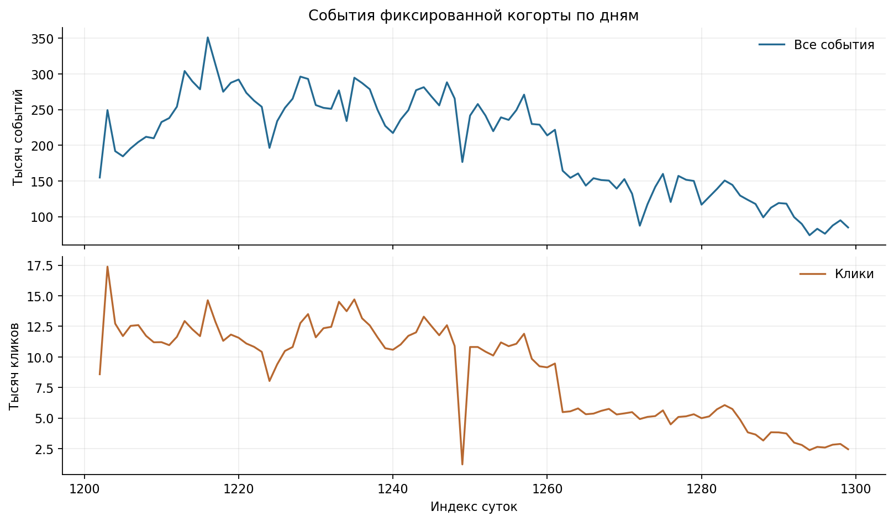
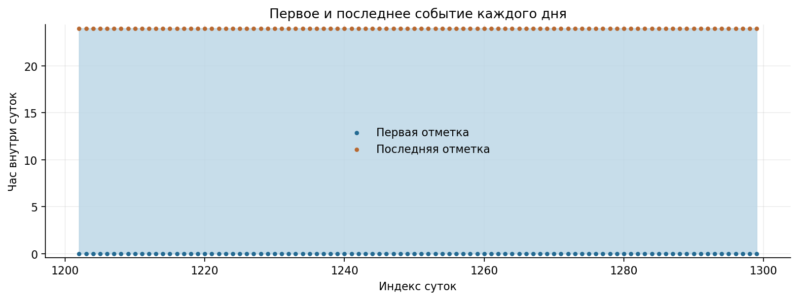

# 01. Данные и протокол

[Ноутбук с результатами](analysis.ipynb) · [Все главы](../../README.md) · [Запуск](../../docs/reproduction.md)

## Что предсказываем

Подсистема выбирает 200 товаров для пользователя из исторически доступного каталога.
Цель — уникальные товары, по которым пользователь кликнет в следующие семь дней.
Повтор товара из прошлой истории разрешён. Это задача предварительного отбора,
поэтому основная метрика — полнота этих 200 кандидатов. Ранжирование внутри списка
проверяется отдельно через NDCG.

Используется T-ECD Small, Marketplace, revision
`79bcf78cd4699267f561ad3fd51fe7b52af53083`.
Числа 1279, 1286 и 1293 — индексы суток датасета, а не календарные даты.

## Размеры и границы

| Что считаем | Размер / правило |
| --- | --- |
| Полный namespace товаров | 2 325 409 |
| Исходная когорта | 80 018 пользователей |
| Выбор когорты | Дни 1202–1261, ≥3 разных strong-товаров, ≥2 дней |
| Обработанные события этой когорты, основной срез | 19 799 501 |
| Основной допустимый каталог | 1 060 869 |
| Товары с корректным вектором | 1 060 839; вектор размерности 300 |
| Основное development-окно | Цели 1293–1299, gap 1292, прошлое до 1291 |
| Запросы / запросы с достижимой целью | 4 335 / 4 319 |
| Достижимые пары пользователь–целевой товар | 16 028 |
| Другие development-окна | Начала 1279 и 1286 |
| Первоначальный профиль | До 60 дней, последние 50 событий |
| Расширенный смешанный профиль | До 50 strong + до 50 view, strong не вытесняются |

Когорта не равна числу пользователей с обучающим позитивом или будущим кликом.
Расширение обучения до 187 356 пользователей в mixed-ветке не меняло фиксированную
когорту оценки. Пользователи вне этой когорты, включая полностью новых, не покрыты
итоговым выводом. При пустом профиле внутри когорты используется популярный добор.

Каталог строится по прошлому: товар должен наблюдаться до разрешённого cutoff и
иметь запись в каталоге. В основных недельных опытах используется прошлое до
90 дней. События однодневного разрыва исключаются из истории, частот и обучения.
Товар, впервые появившийся после cutoff, не может быть рекомендован; он остаётся
в знаменателе полного Recall. Дата появления товара по наблюдаемым событиям
не равна подтверждённой дате его публикации.

## Что проверяли в данных

| Проверка | Наблюдение | Что из этого следует |
| --- | --- | --- |
| Пустые user/item/time, действие, day/timestamp | В обработанном срезе критических ошибок не найдено | Массовая очистка «нулевых строк» не обоснована |
| Пропущенная поверхность показа | 10 150 строк | Признак пригоден для диагностики с отдельным unknown |
| Векторы | Конечность, ненулевая норма, затем L2-нормировка | Некорректный вектор не участвует в content-поиске |
| Повторы | Точные дубликаты и последовательные item/action разобраны отдельно | Повторный интерес не удаляется целиком |
| Срез истории | Сначала cutoff, затем схлопывание последовательных повторов | Событие из будущего не меняет известный префикс |
| Последние сутки | Проверены границы timestamp, объёмы и состав действий | Падение числа событий само по себе не доказывает неполноту |
| Популярность и subdomain | Разобраны всплески и смена поверхностей | Отдельной проверки на фрод не проводилось |
| Отрицательная нормированная цена | Есть в метаданных | Это не основание удалить товар |

График границ показывает первую и последнюю наблюдаемую отметку внутри суток.
Наличие событий около обеих границ не доказывает полноту всех часов. В ноутбуке
неполные по этому признаку дни выводятся как кандидаты для проверки, без удаления.
Подробные агрегаты дубликатов, действий, повторов и атрибутов лежат в
[таблицах аудита](results/).

## Действия и доступность признаков

`view=1`, `click=2`, `like=3`, `clickout=4`; веса 0,1 / 1 / 2 / 3.
Strong означает click, like или clickout. View может обозначать показ, поэтому
его нельзя автоматически считать таким же выраженным интересом, как клик.

ID, события, действия, прошлые частоты и порядок доступны до cutoff.
Векторы товаров предоставлены вместе с датасетом,
но точный момент создания этих статических векторов не подтверждён.
Поэтому результаты поиска по векторам имеют это ограничение исторической доступности.
Категории и поверхности использованы для диагностики. Будущие клики не входят в профиль и sampler-частоты.

## Метрики

Для пользователя `u`: `Y` — будущие уникальные кликовые товары, `C` — допустимый
каталог, `R_k` — первые k различных рекомендаций.

- `Recall_reachable@k = |R_k ∩ Y ∩ C| / |Y ∩ C|`.
  Макроусреднение по пользователям с непустым `Y ∩ C`.
- `Recall_all@k = |R_k ∩ Y ∩ C| / |Y|`.
  Макроусреднение по пользователям с непустым `Y`, включая недостижимые цели.
- `DCG@k = Σ hit(rank) / log2(rank+1)`; `NDCG = DCG / IDCG`,
  идеальная длина равна `min(k, |Y ∩ C|)`.
- NDCG и HR усредняются по пользователям с достижимыми целями. HR — доля таких
  пользователей с хотя бы одним попаданием.
- Покрытие каталога — число различных рекомендованных товаров, делённое на размер
  допустимого каталога. Пустая цель исключается из соответствующей метрики.

Recall 0,30 означает среднюю долю найденных целей пользователя, а не 60 правильных
товаров из 200. Разные окна имеют разную предсказуемость; сравниваем методы внутри
окна, сохраняя пользователей, цели и каталог.

Парный bootstrap пересэмплирует пользователей в разности методов. Он не измеряет
разброс seed и не устраняет оптимизм выбора конфигурации на development.
Финальная неделя 1301–1307 уже открыта; её прежние протокол и результаты сохранены.
Поздние опыты не получили независимого подтверждения на этой неделе.

## Что остаётся ограничением

Онлайн-эксперимент не проводился, изменение CTR не измерялось. Вероятности
показа товаров прежней системой неизвестны; поправка на них не применялась.
Наблюдательные клики зависят от прежней системы показов. Оценка на фиксированной
активной когорте не распространяется автоматически на всех посетителей.
Условия на 5 000 и 20 000 товаров — отдельные диагностические задачи.
