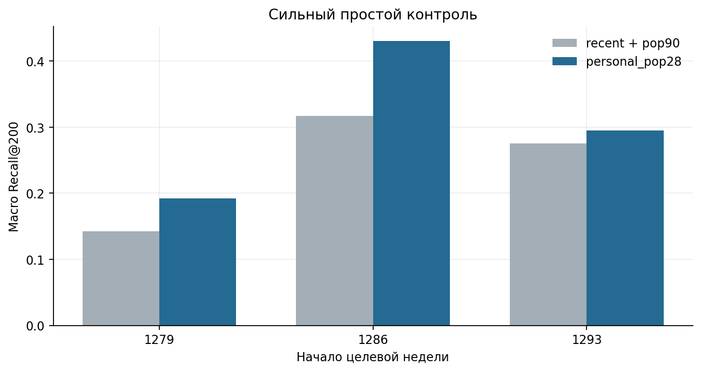
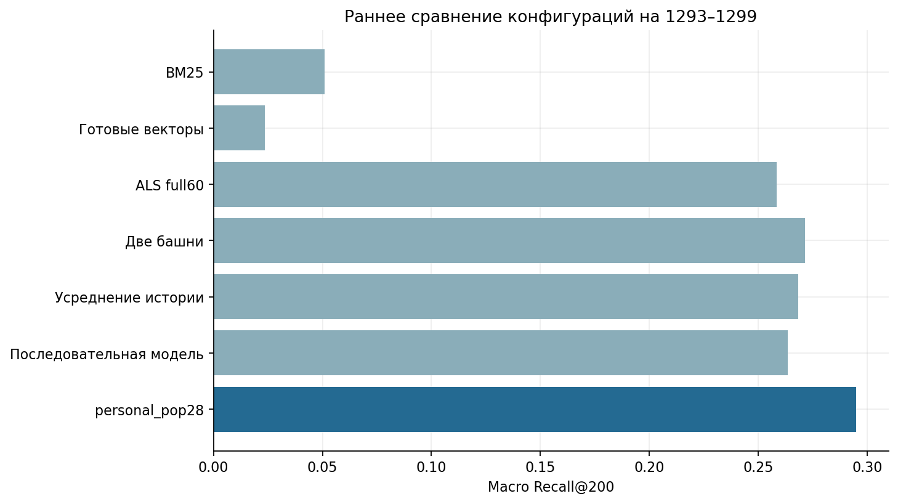
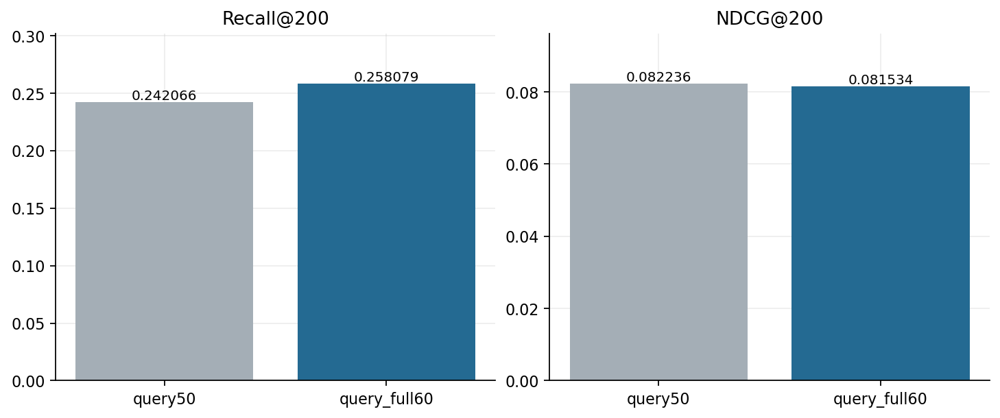
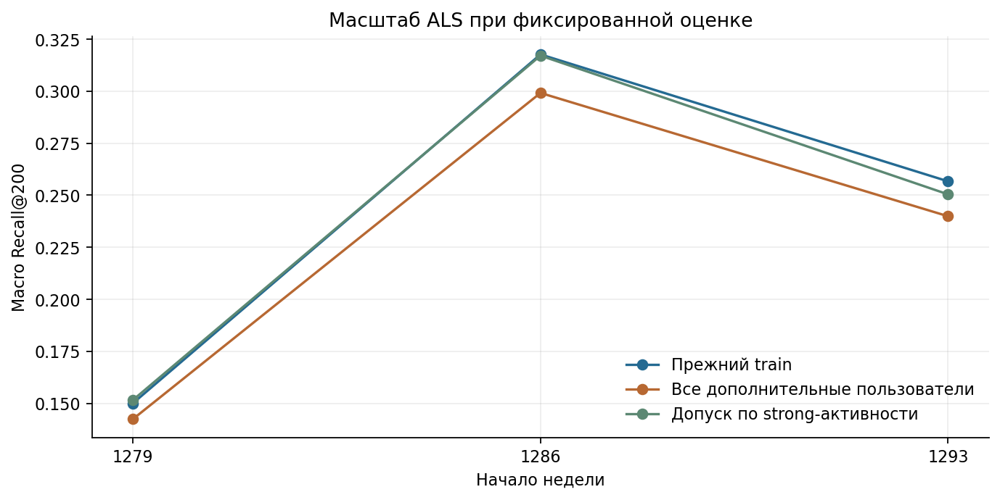

# 02. Базовые и классические методы

[Ноутбук с результатами](analysis.ipynb) · [Все главы](../../README.md) · [Запуск](../../docs/reproduction.md)

## Вопрос

Насколько будущие клики объясняются популярностью, повторным интересом,
соседством товаров, факторизацией и предоставленными признаками? Сложные модели
сравниваем с сильным персональным правилом, а не только с общим популярным топом.

## Методы

| Метод | Как устроен | Что фиксировалось при сравнении |
| --- | --- | --- |
| pop7 / pop28 / pop90 | Частота прошлых кликов за период | Cutoff, каталог, число мест |
| recent | Недавние разные товары пользователя + добор | Допуск повторов и общий fallback |
| personal_pop28 | Личная частота strong за 60 дней + глобальная популярность за 28 дней | Daily max user/item/day, сумма дней, веса 1/2/3 |
| Item-to-item BM25 | Взвешенные совместные интересы; нулевая диагональ | В исходном train до 200 сильнейших товаров пользователя |
| Implicit ALS | 32 фактора, implicit confidence | `1 + 20·log1p(sum_daily_max)`, `alpha=1` |
| Provided content | Взвешенное среднее 300-мерных товарных векторов и точный поиск | L2-нормировка; отсутствие вектора явно учитывается |

В `personal_pop28` число 28 относится к популярному добору. Персональная история
имеет глубину 60 дней. Сначала берётся максимальный вес действия за user/item/day,
затем суммируются дни. При равенстве — более позднее событие, затем ID товара.
Это наша реализация известного семейства персональной популярности; идея не
заявляется как новый алгоритм. Сходное правило TopPers приведено среди базовых методов T-ECD. [Код базовых методов T-ECD](https://github.com/kliakhnovich/tecd-baselines)

## Сильный контроль

**Почему проверяли.** Общий популярный топ может быть слабее простого повторения
личных интересов. Выигрыш сложной модели нужно оценивать относительно второго.

| Начало недели | recent + pop90 | personal_pop28 |
| --- | ---: | ---: |
| 1279 | 0,142167 | 0,191942 |
| 1286 | 0,317067 | 0,430761 |
| 1293 | 0,275049 | 0,295046 |

Personal превзошёл recent на всех трёх неделях. Для дальнейших опытов выбран
personal_pop28. Окна просмотрены ретроспективно, после разработки на основной неделе.

## Сохранённое сравнение на 1293–1299

Во всех строках одинаковы пользователи, каталог, цели и добор.

| method | recall_reachable@200 | recall_all@200 | ndcg@200 |
| --- | --- | --- | --- |
| bm25_strong300 | 0.050890 | 0.048882 | 0.020292 |
| provided_content | 0.023637 | 0.022738 | 0.011662 |
| als_full60 | 0.258313 | 0.248909 | 0.081926 |
| tower8_raw | 0.271460 | 0.260222 | 0.079365 |
| prefix_pool | 0.268336 | 0.257330 | 0.085295 |
| sasrec_like | 0.263624 | 0.252961 | 0.094686 |
| personal_pop28 | 0.295046 | 0.284171 | 0.112669 |

Условия нейросетевых запусков и технический аудит описаны в главе 03 и
[приложении](../appendix_mps/README.md). Рецепты отличаются историей и обучением; вся таблица не является
проверкой влияния только архитектуры. В этой задаче сильный personal-контроль лучше каждой
отдельной модели из таблицы. Полезность ALS в объединении проверена отдельно.

## Полный запросный профиль ALS

**Почему проверяли.** Пользователь мог смотреть целевой товар раньше, чем последние 50
событий. Тогда ограничение хвоста теряет сигнал до расчёта пользовательского вектора.

При тех же товарных факторах заменили последние 50 событий полным профилем за
60 дней. Recall вырос с 0,242066 до 0,258079. Нормы, веса и каталог не менялись;
вклад именно query-профиля отделён от повторного обучения факторов.
Парный аудит использовал прежний добор. После выравнивания добора на pop28
в общей таблице получилось 0,258313. Разность 0,242066→0,258079 относится именно
к отдельному опыту изменения query-профиля.

NDCG изменился с 0,082236 до 0,081534: улучшение полноты не равно улучшению порядка.

Следующая проверка согласовала query-агрегацию с train: daily max и сумма дней
вместо суммы после схлопывания последовательных повторов. Разности Recall ALS
на окнах 1279 / 1286 / 1293: +0,000074 / +0,000395 / −0,000457.
При добавлении к personal с фиксированной квотой 10: −0,000100 / −0,000125 /
+0,000465. Устойчивой прибавки нет. В финальной проверке использован прежний рецепт.

## Размер обучающей аудитории

**Почему проверяли.** Дополнительные взаимодействия могут улучшить товарные факторы,
но малоактивная аудитория может изменить структуру матрицы. Оценку не расширяли
вместе с обучением.

ALS расширяли до примерно 1,2 млн пользователей и 39–40 млн ненулевых user/item-пар.
Оценка осталась на тех же запросах. Самостоятельный Recall ухудшился.
Затем допускали новых пользователей только при ≥3 strong-товарах на ≥2 днях:
получилось около 125–128 тысяч пользователей и 16 млн ненулевых пар.
Часть потери восстановилась, но устойчивого преимущества над прежним train нет.

| Неделя | Прежнее обучение | Все дополнительные | Отбор по strong |
| --- | --- | --- | --- |
| 1279 | 0.150003 | 0.142387 | 0.151555 |
| 1286 | 0.317627 | 0.299108 | 0.317044 |
| 1293 | 0.256639 | 0.239860 | 0.250379 |

Добавление всей дополнительной аудитории снизило Recall отдельного ALS на трёх неделях. Отбор по сильным действиям дал прибавку только на неделе с началом 1279.

## Давность личной частоты

**Почему проверяли.** Частый старый интерес может быть менее актуальным, чем
недавний. Меняли только вес давности, не ALS и не долю каналов.

Задан один half-life 14 дней при прежних 60 днях, daily max и pop28.
Recall@200 точно совпал с контролем на всех трёх неделях: набор первых 200 не
изменился. NDCG изменился на +0,000770 / +0,001445 / −0,000460.
Давность меняет порядок повторных товаров, но не дала нового выигрыша полноты.
Другие half-life в этой проверке не перебирались.

## Вывод

В итоговый простой рецепт вошёл `personal_pop28`. У ALS полезен полный query-профиль,
но большой train и согласованная daily-агрегация не дали устойчивой дополнительной
прибавки. BM25 и content остаются самостоятельными сравнениями и диагностическими
каналами; их слабый отдельный Recall не заменяет проверку вклада при фиксированных
200 местах. Эти проверки описаны в [главе 05](../05_fusion_and_robustness/README.md).

Новое общее сравнение с BM25 K100, затуханием content-профиля и заново обученными
нейросетями приведено в [главе 07](../07_best_models/README.md). Оно использует
тот же период, но выбранные конфигурации отличаются от строк этой таблицы.
