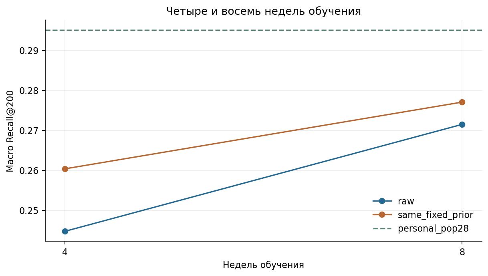
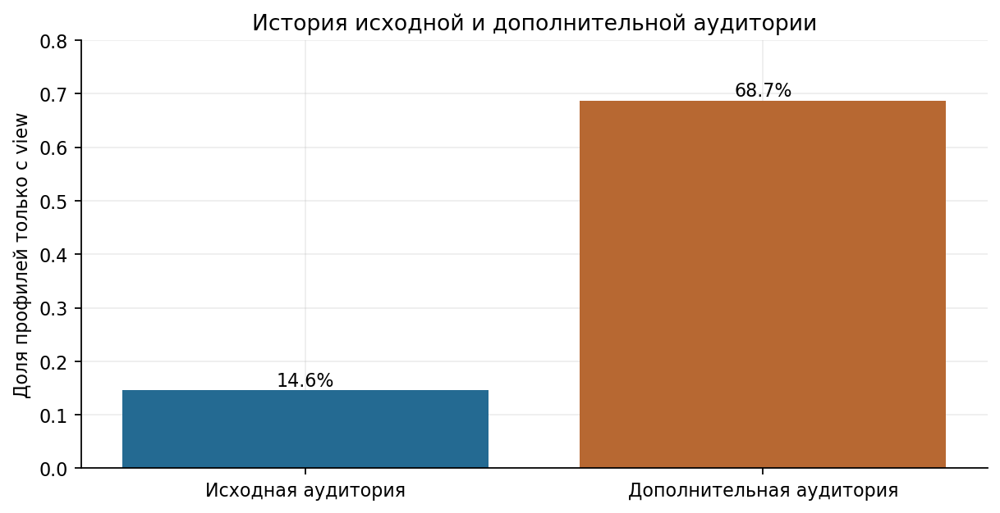
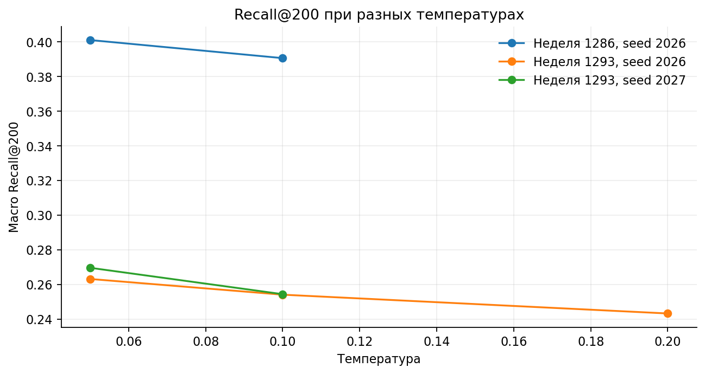
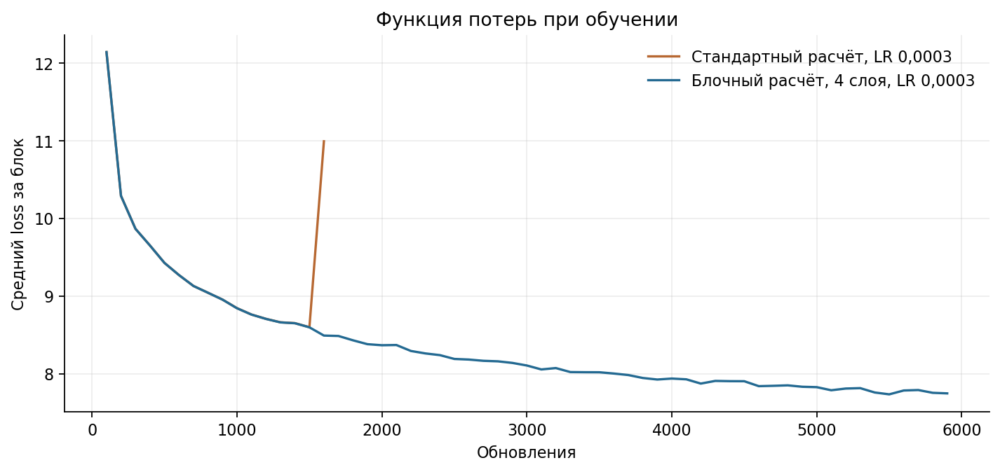
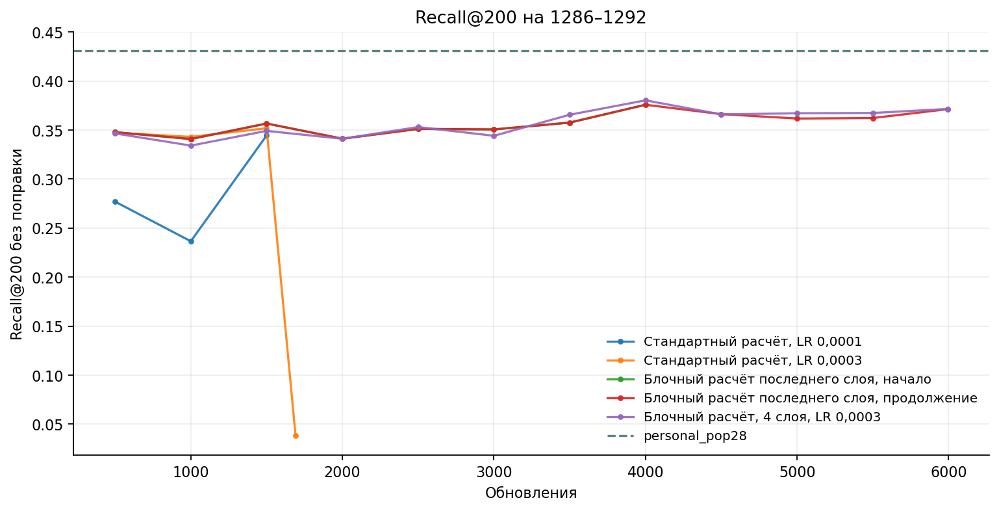
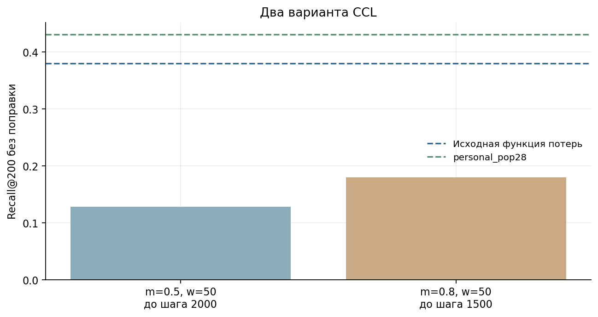

# 03. Двухбашенная модель

[Ноутбук с результатами](analysis.ipynb) · [Все главы](../../README.md) · [Запуск](../../docs/reproduction.md)

## Вопрос

Может ли обучаемое представление истории находить будущие клики лучше личной
частоты и популярного добора? Проверяем два результата: абсолютный Recall и
зависимость выдачи от истории конкретного пользователя.

### Зачем сравнивать свою и чужую историю

На раннем основном запуске TT-ID Recall был около 0,2699 со своей выдачей и 0,2703
после перестановки выдач между пользователями. Одного абсолютного качества
оказалось недостаточно для вывода о персонализации. В последующих опытах вместе
с Recall сохраняли разность «своя история − переставленная».

Большая разность сама по себе не делает метод хорошим: модель также должна
находить больше целей, чем сильный простой контроль.

## Модель и обучающие примеры

Товарная башня: ID-вектор 32, готовый вектор 300 и индикатор его наличия →
Linear333→128 → ReLU → Linear128→64 → L2-нормировка.
В позднем рецепте dropout товарной башни отключён. При выдаче невиденный
обучению ID заменяется padding-ID; содержательная часть при наличии остаётся.

Пользовательская башня: взвешенное среднее товарных векторов истории →
MLP64→128→64, остаточная связь от среднего → L2-нормировка.
Вес действия относится к тому же товару. Отдельного user-ID embedding нет.

Недельный позитив — каждый уникальный кликовый товар user/week, доступный до
прогноза. Профиль заканчивается до gap-дня. Основной ранний профиль — последние 50
событий за 60 дней. Поздний смешанный профиль сохраняет 50 strong и добавляет
до 50 view. Strong означает click/like/clickout с весами 1/2/3; вес view —0,1.

В переносе на неделю 1286 strong-профиль содержал до 50 известных событий,
дополненных нулями до 100 позиций.

## Негативные примеры и критерий

Для обучения на полном каталоге независимо выбираются 256 негативов с возвращением.
Распределение выбора: половина массы равномерная, половина — пропорциональна
числу прошлых кликов в степени 0,75.
Вероятность q(i) вычисляется на доступном каталоге конкретного момента.
Дубликаты негативов сохраняются. Другие позитивы того же user/week маскируются;
вся история пользователя не исключается из негативов.

При `s = cosine / temperature` используется:

`L = log(exp(s_pos) + Σ_unmasked exp(s_neg)/(K·q_neg)) − s_pos`.

Поправка относится к оценке отрицательной части знаменателя. Конечная выборка
и логарифм оставляют погрешность выборочного приближения. Основной способ расчёта сходства — скалярное произведение.
Отдельно показана фиксированная поправка 0,1·(log(q)−mean(log(q))); коэффициент
не подбирается для каждой строки. Точный поиск по каталогу исключает ошибку ANN.
Raw-список дополняется pop28 до 200 мест.

## 1. Полный softmax на 5000 товарах

**Почему.** Проверить, не ограничивает ли качество способ выбора негативов и
приближение знаменателя. На малом каталоге можно вычислить все score.

**Условия.** Общий диагностический каталог 5000, пользователи и цели;
сравниваются полный softmax, mixed sampling без коррекции и importance-вариант.
Качество этого каталога не сравнивается с миллионной задачей.

| Критерий | Recall@200 | Своя − чужая история |
| --- | --- | --- |
| full | 0.439560 | 0.004587 |
| mixed_uncorrected | 0.366821 | 0.034448 |
| mixed_importance | 0.432017 | 0.005511 |

На том же каталоге pop28 дал 0,432347, personal_pop28 —0,452635.
Полный softmax улучшил результат относительно некорректированного sampling,
но не обошёл personal. Прибавка своей истории у полной модели 0,004587,
у personal —0,019655. Изменения loss недостаточно для решения всей проблемы.

Источник: [сравнение критериев](results/investigation_20261104__loss_comparison.csv)
и [простые контроли](results/investigation_20261104__loss_baselines.csv).

## 2. Остаточная связь и состав истории

**Почему.** MLP мог терять полезное среднее истории, а view — вытеснять сильные
события из короткого хвоста. Проверили прямую остаточную связь и смешанную историю,
где последние strong сохраняются независимо от view.

В отдельном аудите входов смешанная история уменьшила число пустых профилей
и сохранила больше целевых товаров внутри профиля:

| История | Пустых профилей | Среднее токенов | Масса целей в истории |
| --- | --- | --- | --- |
| strong | 420 | 13.077047 | 0.082421 |
| mixed | 57 | 46.098501 | 0.134934 |

Последний столбец — поддержка целей входом, не качество рекомендаций.
Улучшение сохранения истории не дало устойчивого превосходства итоговой модели.
Аудит помог отделить потерю сигнала при подготовке от способности модели его использовать.
Residual сохранён в последующих башнях; перенос с малого каталога проверялся отдельно.

## 3. Четыре и восемь недель обучения

**Почему.** Проверить, помогает ли больше прошлых недель при той же когорте и
полном каталоге. Число пар выросло 119 328→307 359; общий максимальный бюджет —4000
обновлений. Это одинаковый бюджет шагов, а не одинаковое число проходов.

| Недель | Оценка | Обучающих пар | Лучший шаг | Recall@200 |
| --- | --- | --- | --- | --- |
| 4 | raw | 119328 | 1000 | 0.244758 |
| 4 | same_fixed_prior | 119328 | 1000 | 0.260367 |
| 8 | raw | 307359 | 3000 | 0.271460 |
| 8 | same_fixed_prior | 307359 | 3000 | 0.277029 |

Raw Recall вырос 0,244758→0,271460, однако personal_pop28 дал 0,295046.
Больше недель помогло этой конфигурации; превосходство над простым методом не получено.
Checkpoint выбирался по raw Recall, фиксированная поправка считалась на тех же весах.

## 4. Расширенная аудитория, признаки и веса примеров

**Почему.** Увеличить число пользователей и поддержку позитивных товаров,
сохранив исходную оценку. Разделили изменение истории и добавление аудитории:
strong_old, mixed_old, mixed_all, затем strong_all.

Объём достиг 774 774 пар и 187 356 пользователей с обучающими примерами. В добавленной аудитории
68,7% профилей имели только view против 14,6% в исходной. Следовательно,
расширение меняло и количество, и состав примеров.

Сравнивались ID/content, два LR, несколько seed и равный вес user/week вместо
равного веса позитивной пары. Устойчивого выигрыша смешанной ветки не получено.
Равный user/week был доведён после ранней остановленной стадии и также не улучшил
заданный рецепт. В результатах указаны число предъявленных примеров и доля
пройденного набора.

[Полная таблица вариантов](results/large_mixed_20261105__completed_comparison.csv).

## 5. Два интереса против случайного разбиения

**Почему.** Проверить, теряет ли одно среднее разные интересы человека.
На фиксированных товарных представлениях сравнили два кластера истории,
случайное разбиение на две части и обычное среднее.

На seed 2026 Recall cluster2/random2/mean был 0,287270/0,287638/0,288211;
на seed 2027 —0,261142/0,260800/0,259705. Устойчивой прибавки кластеров над
случайным контролем нет. Полноценную новую multi-interest модель не обучали.

[Результаты, включая объединения](../05_fusion_and_robustness/results/multi_interest_20261105__comparison.csv).

## 6. Температура

**Почему.** Температура меняет масштаб сходства перед вычислением функции потерь.
Для одной конфигурации задали 0,05/0,1/0,2 без полной сетки сочетаний.
Полезное направление сравнили вторым seed и на более раннем окне с его прошлым.

| Неделя | Seed | Температура | Recall@200 | Своя − чужая |
| --- | --- | --- | --- | --- |
| 1293 | 2026 | 0.100000 | 0.254034 | 0.014736 |
| 1293 | 2026 | 0.050000 | 0.263097 | 0.005892 |
| 1293 | 2026 | 0.200000 | 0.243191 | 0.001575 |
| 1293 | 2027 | 0.100000 | 0.254320 | 0.004465 |
| 1293 | 2027 | 0.050000 | 0.269547 | 0.016425 |
| 1286 | 2026 | 0.100000 | 0.390551 | 0.020021 |
| 1286 | 2026 | 0.050000 | 0.400983 | 0.001406 |

0,05 улучшала raw Recall относительно 0,1, но оставалась ниже personal.
Разность своей и чужой истории не росла одинаково во всех сравнениях.
Фиксированная поправка q также не давала общего направления. Поэтому это
настройка, полезная в этих запусках; устойчивого преимущества над personal нет.

## 7. Длинное обучение и устойчивость

**Почему.** Короткие fit могли останавливаться до полезного улучшения.
Запустили до 8 проходов, LR 0,0003 с начала и резерв 0,0001 при срыве.
Сохранялись loss, validation Recall, нормы градиентов, весов и обновлений.

Численная диагностика выделена в [приложение MPS](../appendix_mps/README.md).
Поздний проверенный контроль: неделя 1286, каталог 1 049 177, 6 302 запроса,
6 278 пользователей с достижимыми целями; 383 441 обучающая пара,
79 689 пользователей, batch512, K256, tau0,1, LR 0,0003.
Он закончил 5992 обновления и 8 проходов; лучший checkpoint — шаг 4000.
Температура сохранена 0,1, чтобы в этой проверке не менять одновременно критерий.

| Оценка | Recall@200 | Своя − чужая история |
| --- | ---: | ---: |
| Raw score + pop28 | 0,380303 | +0,015884 |
| Фиксированная поправка q | 0,397490 | +0,010895 |
| personal_pop28 | 0,430761 | — |

Контроль показывает использование личной истории, но простой метод остаётся выше.
Это один seed на одном окне. Исторические нейросетевые сравнения читаются вместе
с численным аудитом приложения; классический финальный рецепт его не использует.

## 8. Cosine Contrastive Loss

**Почему.** Проверили функцию потерь CCL из SimpleX на прежних данных, башнях и негативных примерах. [Статья о SimpleX](https://arxiv.org/abs/2109.12613) · [Код SimpleX](https://github.com/66chenl/SimpleX)

`L = (1−cos_pos) + w·mean_valid(relu(cos_neg−m))`.

Температура и importance-поправка здесь не применяются. Отрицательная часть
усредняется под прежним proposal q.

| Порог m / вес w | Итог запуска | Лучший raw Recall | Лучший шаг |
| --- | --- | ---: | ---: |
| 0,5 / 50 | Ранняя остановка на шаге 2000 | 0,127965 | 1000 |
| 0,8 / 50 | Обучение остановлено на шаге 1500 | 0,180002 | 1000 |

Оба варианта уступили контролю с поправкой на вероятность выбора негативов. Полная проверка градиентов выполнена для первого варианта.

## Решение

На 1286–1292 правильная история давала больше попаданий, чем переставленная. `personal_pop28` на той же неделе всё равно был сильнее. Для отложенной проверки на 1301–1307 выбрали личную частоту и ALS.

Режим `train` повторяет опыт с обучением на четырёх и восьми неделях. Для остальных опытов в главе показаны сохранённые таблицы. [Настройки прежних запусков](../../configs/experiment_history.json) · [Каталог экспериментов](../../docs/experiment_catalog.md)

В [главе 07](../07_best_models/README.md) strong_all обучен заново на неделе
1293–1299 с блочным расчётом градиентов: 436 991 пара, 86 983 пользователя,
8 проходов. Лучший checkpoint — шаг 500; raw Recall 0,275566, с поправкой —
0,281146. Продолжение обучения не улучшило validation Recall. В объединении
personal + ALS10 + башни10 получено 0,320590, однако personal + pop90 дал 0,326071.
Эти сравнения относятся к разработке, а не к прежнему финальному тесту.
