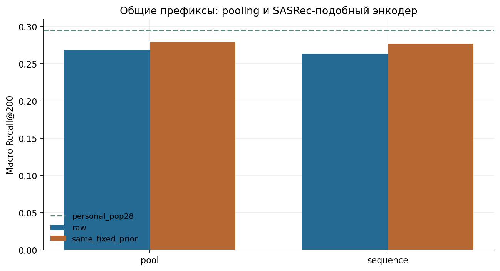
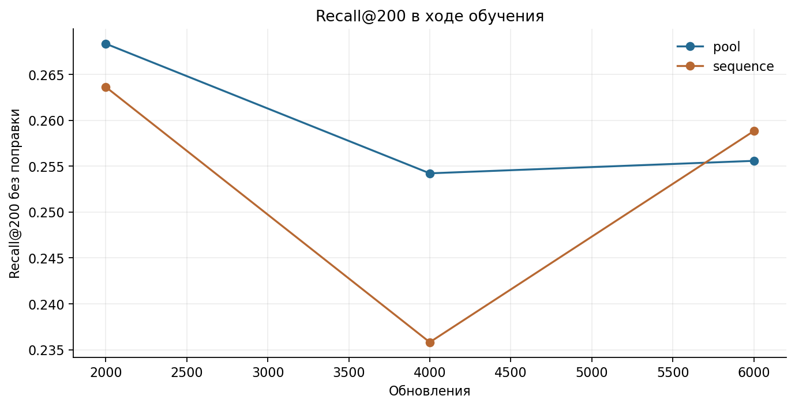
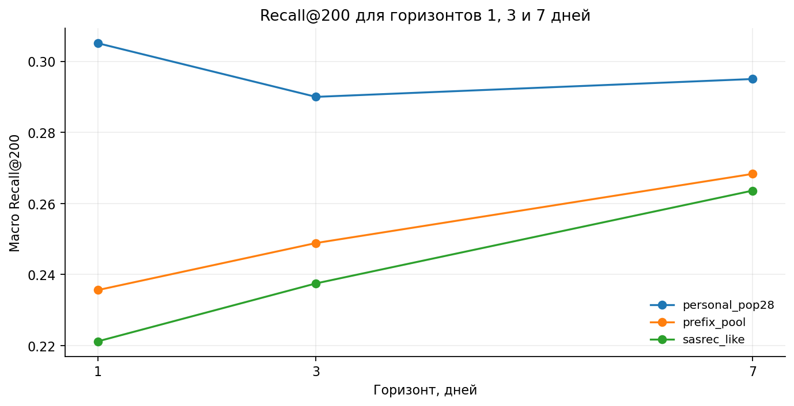

# 04. Последовательная модель и каузальные префиксы

[Ноутбук с результатами](analysis.ipynb) · [Все главы](../../README.md) · [Запуск](../../docs/reproduction.md)

## Вопрос и контроль

Помогает ли порядок событий, если пользовательская история кодируется вниманием?
Сравниваются pooling и SASRec-подобный энкодер на одинаковых префиксах, товарной
башне, sampler, loss, каталоге и оценке. Это компактная адаптация механизма SASRec,
со своим способом подготовки примеров и общей товарной башней. [Статья о SASRec](https://arxiv.org/abs/1808.09781)

## Почему использованы каузальные префиксы

Недельные пары не задают единственную точку внутри последовательности кликов.
Префикс перед конкретным кликом позволяет проверить порядок при одинаковой
известной истории. Разрыв 24 часа сохраняет запрет на ближайшее будущее.
Первый клик user/item/day уменьшает вес повторов одного товара в одни сутки.

## Подготовка

Получено 334 094 пары, 53 696 пользователей и 55 902 положительных товара.
Позитив — первый click user/item/day. Для каждого позитива история ограничивается
моментом `target_time−24 часа`, глубиной 60 дней и максимумом 100 событий при подготовке. В сохранённых
конфигурациях обоих энкодеров используются последние 50 событий.
Сначала определяется известный префикс, потом схлопываются последовательные
item/action. Будущее продолжение серии не меняет конец известной истории.

Негативные товары выбираются из доступного на тот момент каталога. Для ранних примеров доступная история короче 60 дней.

## Почему нужен pooling-контроль

Смена недельных пар на префиксы сама по себе меняет обучение. Поэтому attention
сравнивается с pooling на тех же префиксах, товарной башне, sampler и loss.
Так можно отделить новый набор примеров от добавления обработки порядка.

## Энкодер

Один Transformer-блок, 2 головы, размерность 64, FFN 128, dropout 0,1,
причинная маска, обучаемая позиция. Товарные токены умножены на sqrt(64), чтобы
соотнести их масштаб с позиционным embedding. Padding маскируется; для пустого
профиля обрабатывается безопасная позиция. Выход берётся с последнего известного
токена и проходит ту же residual user-часть, что у pooling.

В notebook находятся конкретная экспериментальная архитектура и код построения
префиксов. Повторно используемая товарная башня импортируется из общего пакета.

## Исходное сравнение на 1293–1299

| Метод | Raw + pop28 | С фиксированным offset | Своя − чужая, raw |
| --- | ---: | ---: | ---: |
| Prefix pooling | 0,268336 | 0,279342 | +0,019259 |
| SASRec-подобный | 0,263624 | 0,276956 | около +0,00026 |
| personal_pop28 | 0,295046 | — | — |

При перестановке токенов raw-разность «исходный порядок − переставленный»
равна −0,000309, bootstrap 95% CI [−0,000991; +0,000293], одна перестановка seed.
Разность близка к нулю, интервал включает 0. Перестановка не дала заметного
снижения Recall@200 в этом опыте. Это диагностика входа при фиксированных
весах; отдельные модели на переставленных последовательностях не обучались.

## Горизонты 1 / 3 / 7 дней

Показаны естественные множества пользователей с целями для каждого горизонта.
Отдельно в таблице сохранён одинаковый набор пользователей с целями первого дня: без неё разность между
горизонтами включает смену пользователей. Checkpoint ранее выбирался по недельному
качеству; это исследовательский разрез, а не независимый выбор лучшего горизонта.

## Решение и границы вывода

Последовательный энкодер не включён в зафиксированный финальный рецепт: ни абсолютное качество, ни диагностика
порядка не показали преимущества над pooling и personal. Реализация сохранена
как отдельный метод исследования.

Исходное сравнение проводилось со стандартным расчётом градиентов. [Проверка CPU и MPS](../appendix_mps/README.md)

В [главе 07](../07_best_models/README.md) последовательная модель обучена заново
с блочным расчётом градиентов общих линейных слоёв. Raw Recall — 0,254535,
с фиксированной поправкой — 0,271521. Добавление 10 мест к personal дало
0,299685 против 0,295046 у personal. Контроль с усреднением истории и перестановка
токенов в этом новом запуске повторно не выполнялись.
