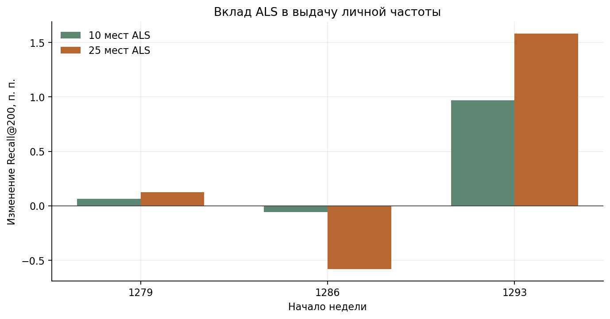
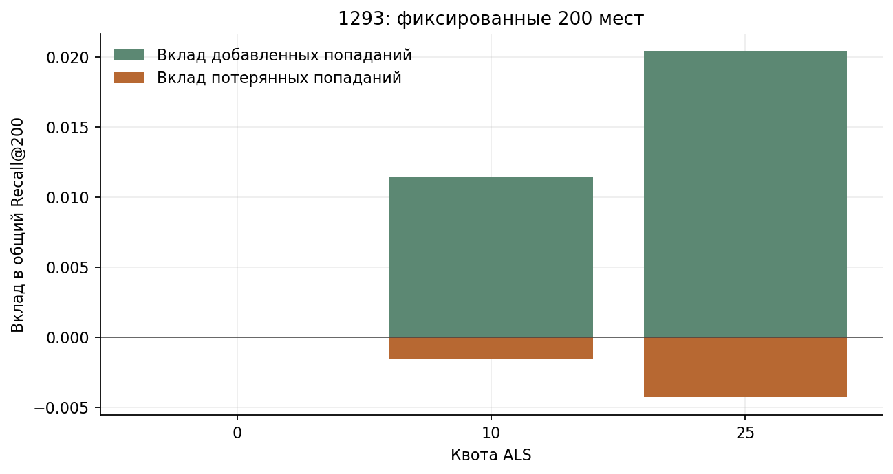

# 05. Объединение выдач и устойчивость

[Ноутбук с результатами](analysis.ipynb) · [Все главы](../../README.md) · [Запуск](../../docs/reproduction.md)

## Вопрос

Проверяем, находят ли ALS и другие методы товары, пропущенные `personal_pop28`. В каждом списке ровно 200 мест. Когда новый товар занимает место из старой выдачи, считаем и добавленные, и потерянные попадания.

## Как объединяем

Используется фиксированный weighted round-robin с удалением дубликатов.
Квота ALS 10 означает расписание 190/10; когда кандидат уже встречался, берётся
следующий допустимый товар. Порядок расписания является частью рецепта и сохранён
в `src/recsys_lab/fusion.py`. Объединение использует позиции в списках, а не значения сходства разных моделей.

У каждого пользователя делим добавленные и потерянные попадания на число его достижимых целей. Затем усредняем обе доли по пользователям. Их разность даёт изменение macro Recall.

## Что получилось

На основном development-срезе раннее объединение personal_pop28 с 25 местами
общего топа pop90 дало 0,326071 против 0,295046 у personal_pop28. Это объединение
двух простых контролей; ALS в нём не участвовал. На двух других неделях тот же старый
рецепт проиграл personal. Знак эффекта зависит от периода; поэтому перешли к сравнению
квот и нескольких seed при общем доборе.

В позднем сопоставимом пересчёте с общим pop28, тремя seed и полным ALS-профилем:

| Anchor | personal | personal + ALS10, mean | personal + ALS25, mean |
| --- | ---: | ---: | ---: |
| 1279 | 0,191942 | 0,192598 | 0,193203 |
| 1286 | 0,430761 | 0,430187 | 0,424953 |
| 1293 | 0,295046 | 0,304724 | 0,310869 |

Квота 25 сильнее помогает на третьей неделе и сильнее вредит на второй.
Квота 10 уменьшает этот компромисс; итоговый рецепт был зафиксирован до открытия
недели 1301. Более поздние daily-агрегация или температурные опыты его не меняют.

## Repeat, новые товары и холодные относительно train

Цели разделялись на повтор товара из истории, новый товар в знакомой категории
и новую категорию. Отдельно считалось, был ли товар в последних 50 событиях или
только в длинной истории. Так проверялось, теряется ли сигнал до самой модели.
Популярное в любимых категориях сравнивалось как простой персональный контроль.

Сравнивались repeat-канал ALS и повтор последних товаров при одинаковых 10 местах.
На основном окне повторный ALS оказался полезнее recency, но на средней неделе
оба могли уступать одному personal. Для cold-канала выбирались товары без
supervised-позитива в train, хотя view/другие прошлые события у них могли быть.
Это не товары вне каталога. Три content-рецепта с квотой 10 проиграли контролю на
всех трёх окнах. Подробности сохраняют и added, и lost, включая repeat/new-разрезы.

При одинаковом доступном наборе повторных кандидатов:

| Неделя | Personal | С повторным ALS | С недавними товарами |
| --- | --- | --- | --- |
| 1279 | 0.191942 | 0.192356 | 0.193132 |
| 1286 | 0.430761 | 0.428244 | 0.428138 |
| 1293 | 0.295046 | 0.306381 | 0.299248 |

На 1293 ALS использует повторные интересы лучше простого выбора по давности.
На 1286 оба варианта уступают personal; общего выигрыша повторного канала нет.

## Контроль популярных товаров в любимых категориях

**Почему.** Проверить, есть ли полезная простая персонализация для новых товаров,
которую не используют башни. Строили популярный топ в прошлых категориях человека
и отдельный канал новых товаров с квотой 10. На неделях 1279/1286/1293 этот канал
дал 0,192402/0,431005/0,296336 против 0,191942/0,430761/0,295046 personal.
Прибавка на каждой неделе меньше 0,13 процентного пункта. Отдельный список популярных товаров по категориям уступил `personal_pop28`.

## Другие проверки устойчивости

| Проверка | Вывод и предел |
| --- | --- |
| Три ALS seed | Разброс обучения мал, но знак эффекта зависит от недели |
| Согласованная query daily-агрегация | Нет общего выигрыша на трёх окнах |
| Personal half-life 14 | Набор 200 тот же; местами лучше NDCG |
| Большая ALS-популяция | Не улучшила устойчиво прежний train |
| Два кластера истории при фиксированных товарных векторах | Нет устойчивой прибавки относительно случайного разбиения истории |
| Своя / переставленная история | Диагностика персонализации, а не самостоятельная продуктовая метрика |
| Парный bootstrap | Неопределённость по запросам; не поправка за выбор лучшего из многих опытов |

Ранние окна просмотрены ретроспективно после основной разработки. Разброс seed и bootstrap — разные источники
неопределённости. Для позднего NN-подбора нужен новый независимый период.

## Решение

Для финальной проверки 1301–1307 были зафиксированы personal_pop28 и ALS с квотой 10.
Автоматически добавлять content, BM25 и последовательный канал оснований нет.
Они сохранены как проверенные направления, а не как обязательные участники выдачи.
Результат этого протокола находится в следующей главе.

Позднее общее сравнение всех пяти методов находится в [главе 07](../07_best_models/README.md).
На 1293–1299 personal + ALS10 + башни10 дал 0,320590, personal со всеми пятью
методами — 0,318208, personal + pop90 — 0,326071. Новые объединения проверены
на одной неделе разработки; результат финальной проверки ими не заменяется.
