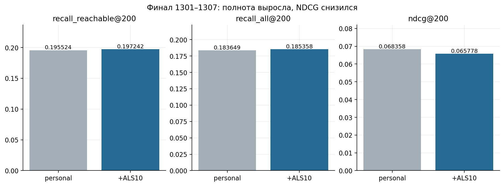
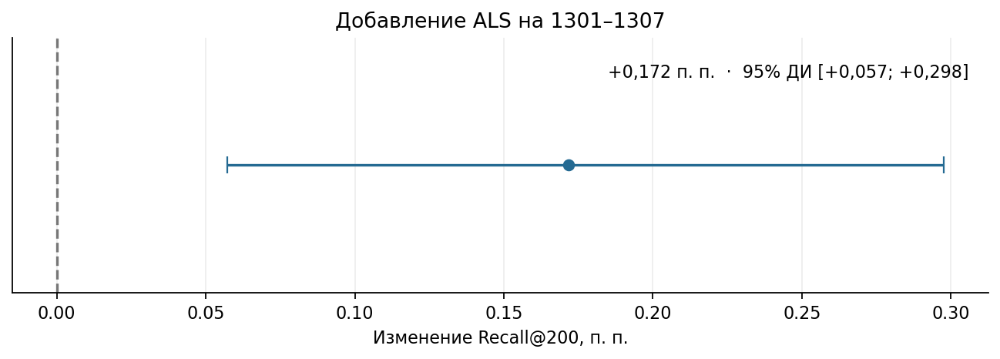

# 06. Отложенная проверка зафиксированного решения

[Ноутбук с результатами](analysis.ipynb) · [Все главы](../../README.md) · [Запуск](../../docs/reproduction.md)

## Почему понадобилась отдельная финальная неделя

На просмотренных неделях квоты и методы уже сравнивались много раз. Для проверки
выбранного рецепта зафиксировали personal и ALS10 до чтения финальных целей.
Задача опыта — измерить разность на будущем периоде при одинаковых 200 местах.

## Зафиксированный финальный опыт

До оценки сохранены два рецепта: personal_pop28 и personal_pop28 + ALS10.
Для отбора использовали данные за дни 1210–1299. День 1300 пропустили. Качество оценили по кликам за дни 1301–1307.
Когорта — прежние 80 018; каталог строится по доступному прошлому.
ALS: 32 фактора, reg 0,1, 10 итераций, alpha 1, seed 2026;
полный 60-дневный query с прежней агрегацией. Квота 10 не подбиралась на финале.
Запросов 3 503, пользователей с достижимыми целями 3 481.

| method | recall_reachable@200 | recall_all@200 | ndcg@200 |
| --- | --- | --- | --- |
| personal_pop28 | 0.195524 | 0.183649 | 0.068358 |
| personal_als_b10 | 0.197242 | 0.185358 | 0.065778 |

Разность основного Recall — **+0,001717**, или **+0,172 процентного пункта**,
примерно +0,88% относительно personal. Сохранённый парный 95% интервал:
[+0,000573; +0,002976], 2 000 bootstrap-повторов.
Объединение добавило 32 попадания по парам «пользователь — товар» и потеряло 15. Полный Recall вырос, NDCG снизился на 0,002580. Онлайн-эксперимент не проводился.

Первичное значение bootstrap сохранено отдельно. Ноутбук повторно вычисляет
интервал по обезличенным парным метрикам. Из-за другого seed/порядка генератора
границы могут немного отличаться; средняя разность должна совпасть.
Сырые события и соответствие строк исходным пользовательским ID в Git не входят.

## Проверка и стоимость

Цели и Recall независимо пересчитаны по сохранённым сырым целям и выдачам.
ALS-fit занял 32,27 секунды; fold-in и поиск для запросов — 43,82 секунды
в данном запуске M2 Air 16 ГБ. Это не универсальный benchmark оборудования.
Время personal отдельно не измерялось. Ноль в его `fit_seconds` означает отсутствие
обучаемых факторов. Одинаковое поле `als_predict_seconds` в двух строках — общий
замер этапа ALS, а не стоимость baseline.

## Что следует из всей работы

1. Сильная персональная популярность существенно меняет оценку других моделей.
   На трёх неделях `personal_pop28` был сильнее `recent + pop90`.
2. При тех же товарных факторах ALS полный профиль за 60 дней дал больший Recall, чем последние 50 событий.
3. Небольшое включение ALS добавляет цели, но эффект зависит от периода и квоты.
   Один финальный будущий период дал небольшую положительную разность Recall.
4. Большой train сам по себе не дал устойчивой прибавки. Состав действий и
   обучающих контекстов меняется вместе с размером популяции.
5. На 1286–1292 башни с блочным расчётом градиентов использовали сигнал личной истории и уступили `personal_pop28` по Recall.
6. Перестановка событий в последовательной модели почти не изменила Recall. В этом опыте использовался стандартный расчёт градиентов MPS.
7. Два проверенных варианта CCL уступили исходному критерию обучения.

## Границы оценки

На неделе 1301–1307 проверили только два заранее заданных варианта. Опыты с температурой, скоростью обучения, способом расчёта градиентов и CCL проводились на неделях разработки. [Сравнение пяти методов на 1293–1299](../07_best_models/README.md)
