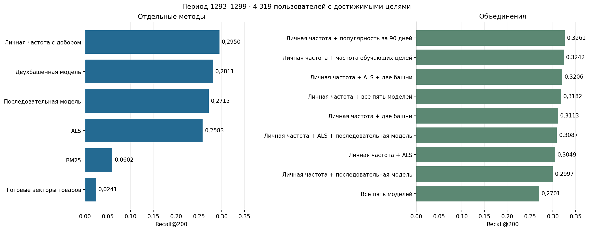

# 07. Сводное сравнение моделей на периоде разработки

Ноутбук сравнивает пять методов отбора. BM25, ALS и нейросети обучаются на прошлых событиях. Поиск по готовым векторам строит профиль из истории пользователя. Таблицы и графики сохранены в выполненном ноутбуке. [Открыть ноутбук](analysis.ipynb)

## Что проверяем

Сравниваем методы на неделе 1293–1299. Во всех оценках одинаковы пользователи, каталог и будущие клики. В каждом списке 200 товаров.

| Метод | Конфигурация |
| --- | --- |
| BM25 | Strong-действия в обучении и запросе, 100 соседей на товар |
| ALS | 32 фактора, регуляризация 0,1, 10 итераций; запросный профиль за 60 дней |
| Векторы товаров | Предоставленные 300 признаков; последние 50 событий, веса с полураспадом 7 дней |
| Две башни | ID и признаки товаров, взвешенная история с остаточной связью; LR 0,0003, температура 0,1, 8 проходов |
| Последовательная модель | Последние 50 событий, один слой внимания, 2 головы, размерность 64; 6000 обновлений |

Контроли: `pop28`, `pop90`, `personal_pop28` и частота обучающих целевых товаров. Для ALS также сохраняется вариант запроса по последним 50 событиям. Для итоговых таблиц короткие выдачи всех методов дополняются одним и тем же `pop28`. Оценки до приведения к общему добору записываются в журнал классических методов.

Для нейросетей checkpoint выбирается по Recall@200 без поправки на популярность. На этих весах сравниваются скалярное произведение и фиксированная поправка logQ с коэффициентом 0,1. В объединения входит вариант с лучшим Recall на этой неделе; обе оценки сохраняются.

## Данные и метрики

Каталог: 1 060 869 товаров. В оценке 4 335 пользователей с будущими кликами; у 4 319 есть достижимые цели. Цели — уникальные товары кликов за дни 1293–1299. История ограничена прошлым, день 1292 пропускается. Повторные товары разрешены.

Обучение использует прошлое относительно недели оценки:

| Метод | Период и объём |
| --- | --- |
| ALS и BM25 | События 1202–1291; 80 018 пользователей исходной когорты |
| Две башни | 8 целевых недель с началом 1235, 1242, 1249, 1256, 1263, 1270, 1277 и 1284; последняя заканчивается 1290. 436 991 пара, 86 983 пользователя |
| Последовательная модель | Целевые клики 1235–1291; история каждого примера заканчивается минимум за 24 часа до клика. 334 094 примера, 53 696 пользователей |
| Личная частота | Strong-действия за 1232–1291; популярный добор за 1264–1291 |
| Поиск по векторам | Профиль по последним 50 событиям в пределах 60 дней; предоставленные векторы не переобучаются |

Для двух башен берём до 50 сильных действий за 60 дней и дополняем вход нулями до 100 позиций. Дополнительные пользователи входят только в обучающую выборку. Товарная и пользовательская башни обучаются совместно.

Главная метрика — macro Recall@200 по пользователям с достижимыми целями. Дополнительно сохраняются полный Recall и NDCG; время обучения и выдачи приведено там, где оно измерялось. В сравнении объединений считаются добавленные и вытесненные цели, а также парный bootstrap по пользователям. Пересечение выдач показывает, насколько разные товары находят методы.

## Зависимость от периода

1293–1299 — основная неделя разработки, на которой уже сравнивались настройки. Она сохранена для общего запуска пяти моделей. В более ранних опытах ALS обучался заново для каждой недели, только на её прошлом:

| Неделя оценки | Последний день данных обучения | personal_pop28 | personal + ALS25¹ | personal + pop90, 25 мест |
| --- | ---: | ---: | ---: | ---: |
| 1279–1285 | 1277 | 0,191942 | 0,193203 | 0,188727 |
| 1286–1292 | 1284 | 0,430761 | 0,424953 | 0,419646 |
| 1293–1299 | 1291 | 0,295046 | 0,310869 | 0,326071 |

¹ Среднее по трём seed ALS. В каждой строке одинаковые условия оценки для сравниваемых методов. Между периодами меняются каталог, будущие цели и число активных пользователей выбранной когорты: 9 828, 6 302 и 4 335 соответственно.

Recall личной частоты меняется от 0,1919 до 0,4308. Добавление pop90 снизило Recall на первых двух неделях и повысило на третьей.

Две башни отдельно обучались для оценки на 1286–1292: 383 441 пара, 79 689 пользователей, 8 проходов с блочным расчётом градиентов. Recall с фиксированной поправкой составил 0,397490 против 0,430761 у personal. Более ранний период не устранил отставание от простого контроля. Все пять моделей в конфигурациях этой главы на всех трёх неделях не обучались.

Проверки суточных файлов, timestamp и состава событий не подтвердили повреждение последней недели. Полнота выгрузки во всех часах при этом не доказана. Данные и проверки описаны в [главе 01](../01_data_and_protocol/README.md), временные сравнения — в [главе 05](../05_fusion_and_robustness/README.md).

## Объединения

Квоты записаны в [конфигурации](../../configs/best_models.json) до запуска. Проверяются:

- `personal_pop28` с 10 местами ALS, двухбашенной или последовательной модели;
- `personal_pop28` с ALS и одной из нейросетей — по 10 мест на дополнительный канал;
- `personal_pop28` со всеми пятью моделями;
- все пять моделей без `personal_pop28`;
- `personal_pop28` с 25 местами `pop90` или 10 местами частоты обучающих целей.

Дубликаты удаляются при объединении. Итоговая выдача содержит 200 товаров. Популярные каналы помогают проверить, даёт ли нейросеть пользу сверх частотного сигнала.

## Запуск

Нужны зависимости `.[training]` и сырые файлы T-ECD в `data/raw` либо по пути из переменной `T_ECD_RAW`. Необязательный `data/prepared_reference` позволяет использовать подготовленные входные массивы. Веса и рекомендации обучаются и рассчитываются в каталоге текущего запуска. Нейросети используют MPS.

Выполните ячейки по порядку. Результаты записываются в `local_runs/<RUN_NAME>/engine/bench_results`, компактные таблицы — в `results/` этой главы, графики — в `figures/`. При повторном выполнении с тем же `RUN_NAME` законченные этапы используются повторно. Для отдельного обучения задайте другое имя запуска.

## Результаты общего запуска

Recall@200 на 1293–1299:

| Метод или объединение | Recall@200 |
| --- | ---: |
| personal_pop28 | 0,295046 |
| BM25 | 0,060203 |
| ALS, профиль за 60 дней | 0,258313 |
| Векторы товаров с затуханием истории | 0,024058 |
| Две башни с фиксированной поправкой | 0,281146 |
| Последовательная модель с фиксированной поправкой | 0,271521 |
| personal + ALS10 + две башни10 | 0,320590 |
| personal + все пять моделей | 0,318208 |
| personal + частота обучающих целей10 | 0,324211 |
| personal + pop90, 25 мест | 0,326071 |

На этой неделе наибольший Recall среди отдельных методов у личной частоты, среди объединений у личной частоты с `pop90`. У двух башен Recall без поправки достиг максимума на шаге 500. После восьми проходов он был ниже.

Полные значения, NDCG и парные интервалы находятся в `results/model_comparison.csv` и `results/fusion_comparison.csv`.

## Границы сравнения

На периоде 1293–1299 выбирались настройки и варианты выдач нейросетей. Отложенная проверка на 1301–1307 относится к заранее зафиксированному объединению личной частоты и ALS. [Глава 06](../06_final_results/README.md)
