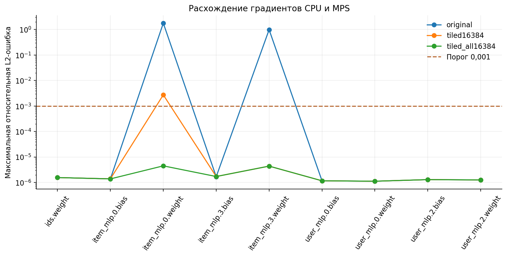
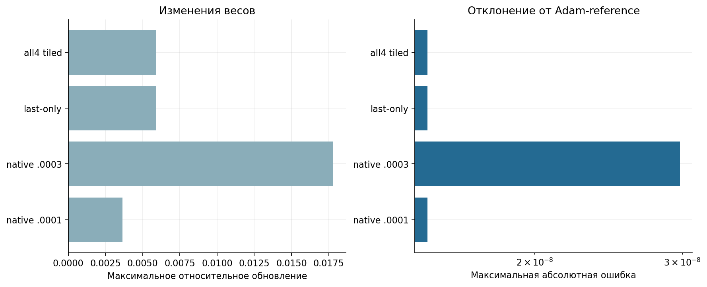

# Приложение. Численная проверка MPS

[Ноутбук с результатами](analysis.ipynb) · [Все главы](../../README.md) · [Запуск](../../docs/reproduction.md)

## Расхождение градиентов CPU и MPS

При длительном обучении обнаружили нестабильность. На одинаковом пакете примеров loss на CPU и MPS совпадал, а градиенты весов линейного слоя иногда заметно различались. Отдельно сравнили loss, градиенты и шаг AdamW.

## Последовательность проверок

| Проверка | Результат | Интерпретация |
| --- | --- | --- |
| AdamW одной матрицы CPU/MPS | Обновления близки | Этот тест не выявил ошибки самого оптимизатора |
| Шаг AdamW и эталонный расчёт | Расхождение порядка 10⁻⁸ | Обновления сравнивали при одном и том же градиенте |
| Стандартный Linear на фиксированном реальном batch | Иногда большие dW-расхождения при совпадении loss | Требуется отдельная проверка backward |
| Блочная редукция только последнего Linear | Промежуточные проверки прошли | Финальная проверка выявила расхождение в первом Linear |
| Блочный расчёт во всех четырёх слоях | Проверки прошли | Этот способ использовали в восьмипроходном запуске |
| CPU float64 identity | Максимум около 1,78·10⁻¹⁵ | Формула backward проверена независимо на малом входе |
| Финальный реальный batch, восемь повторов | Все четыре слоя: относительная L2-ошибка до 4,48·10⁻⁶ | Ошибка ниже заданного порога 0,001 на этом batch |

Относительная ошибка считается как `||grad_MPS−grad_CPU||₂ / ||grad_CPU||₂`.
Малые нормы требуют осторожной трактовки; в исходных JSON сохранены и нормы,
и максимальные абсолютные ошибки. Для всех вариантов использован один порог сравнения.

В подписях `native` означает стандартный расчёт PyTorch, `last-only` — блочный расчёт только последнего слоя, `all4` — всех четырёх общих линейных слоёв.

## Блочный расчёт градиентов

Forward остаётся `Y = XWᵀ + b`. Backward:
`dX = GW`, `dW = Σ_blocks G_blockᵀX_block`, `db = Σ_blocks G_block`.
Размер блока 16 384. Формула, параметры и начальные веса те же; порядок редукции
изменён. Код расположен в `src/recsys_lab/tiled_linear.py` и используется в нескольких запусках.
Проверены производные первого порядка для используемой башни.
Производные высших порядков и другие модели в этот аудит не входили.

В notebook можно проверить математическое равенство на CPU float64.
Проверка MPS вынесена под явный переключатель; она не запускает обучение.
Новый полный численный аудит реального batch требует локальных внешних артефактов.

## Влияние на основные выводы

Расхождение обнаружено при обучении нейросетей на MPS. Для интерпретации ранних запусков важно учитывать, что они использовали стандартный расчёт градиентов. Причина расхождения не установлена.

С блочным расчётом модель прошла восемь эпох. На 1286–1292 её Recall был ниже, чем у `personal_pop28`. Этот способ расчёта использован и в главе 07.
